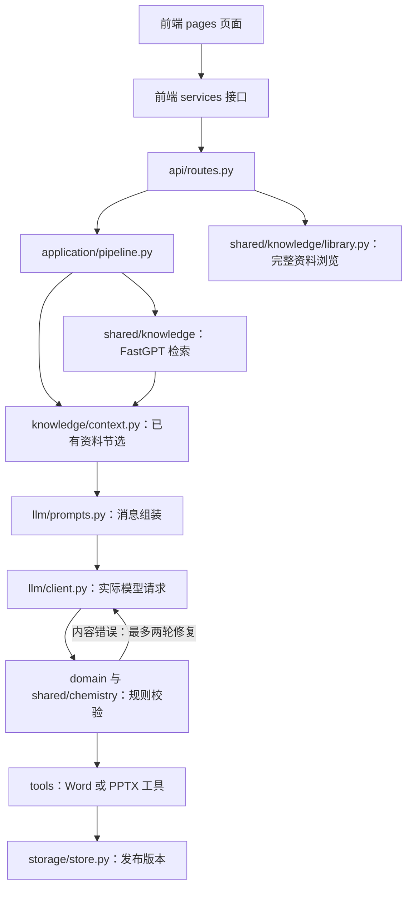

# 三个 Agent 的功能目录与调用链

三个 Agent 的代码已按功能实际迁移到子目录。关键代码保留中文职责标签，可搜索 `【模型调用`、`【知识库调用`、`【规则处理`、`【文档工具`。

## 后端目录

```text
backend/app/
├── main.py                       # FastAPI 入口，装配三个 Agent
├── paths.py                      # 统一定位仓库、vendor 与模板
├── config.py                     # 原有真实配置，位置不变
├── study_guide/                  # 导学案
├── courseware/                   # 互动课件
├── timed_practice/               # 限时练习
└── shared/                       # 知识库、化学处理、文件工具和通用课时提示
```

各 Agent 的功能目录：

| 目录 | 职责 | 典型文件 |
| --- | --- | --- |
| `api/` | HTTP 接口：会话、资料、后台任务、预览和下载 | `routes.py` |
| `application/` | 调用顺序、修复轮次与成功／失败处理 | `pipeline.py` |
| `llm/` | 实际模型请求与提示词定义 | `client.py`、`prompts.py` |
| `domain/` | 数据约束、确定性规则、修订范围和排版规则 | `models.py`、`revision.py`、`requirements.py` |
| `knowledge/` | 对已有来源做节选与上下文预算控制 | `context.py` |
| `tools/` | Word／PPTX 生成、原图快照与下载适配 | `documents.py`、`export.py`、`images.py` |
| `storage/` | 独立 SQLite 会话、任务、来源和版本保存 | `store.py` |
| `configuration/` | 课件／练习的配置覆盖适配 | `settings.py` |

只有实际需要的目录才创建。导学案继续使用应用基础配置；配置文件、数据库、上传和版本目录均保持原位置。

## 调用链



这是共同职责示意；修订可以复用已保存证据，各流程的精确顺序与错误分支见 `application/pipeline.py`。模型、网络或原图服务故障不能靠改写内容来修复。

## 关键边界

- `llm/prompts.py` 只定义提示词和消息；真正的模型网络请求在 `llm/client.py`。
- `knowledge/context.py` 处理已有资料，不访问 FastGPT；远程检索入口是 `shared/knowledge/retrieval.py`。
- `shared/knowledge/library.py` 提供完整资料同步／原文地址，独立于任务的语义召回。
- “工具”是应用直接调用的 Python 文件、图片和渲染函数；当前并非模型自主发起的 tool calling。
- 提示词中的要求还要由 Python 规则验证；模型返回的来源和核验声明不能覆盖真实证据。
- 导学案按块 ID 与哈希修订，课件保护指定页之外的内容，练习保护指定题之外的内容。
- 练习 `tools/documents.py` 当前同时提供 `validate_content()` 规则入口和 `render()` 文档入口，两者已分别用中文标注。
- 导学案化学校验／修复仍复用课件 `domain/equations.py` 的无状态解析函数，这是已有依赖；修改时须同时验证三个 Agent。

## 后端文件位置

### 导学案：`backend/app/study_guide/`

| 文件 | 职责分类 |
| --- | --- |
| [api/routes.py](../backend/app/study_guide/api/routes.py) | HTTP 接口与响应 |
| [application/pipeline.py](../backend/app/study_guide/application/pipeline.py) | 生成／修订流程编排 |
| [domain/models.py](../backend/app/study_guide/domain/models.py) | 数据合同、业务规则、化学处理与修订保护 |
| [domain/table_repair.py](../backend/app/study_guide/domain/table_repair.py) | 数据合同、业务规则、化学处理与修订保护 |
| [knowledge/context.py](../backend/app/study_guide/knowledge/context.py) | 资料上下文节选与预算规则 |
| [llm/client.py](../backend/app/study_guide/llm/client.py) | 模型请求、流式响应与提示词 |
| [llm/prompts.py](../backend/app/study_guide/llm/prompts.py) | 模型请求、流式响应与提示词 |
| [storage/store.py](../backend/app/study_guide/storage/store.py) | 会话、任务与版本存储 |
| [tools/documents.py](../backend/app/study_guide/tools/documents.py) | Word／PPTX、原图与下载工具 |
| [tools/images.py](../backend/app/study_guide/tools/images.py) | Word／PPTX、原图与下载工具 |

### 互动课件：`backend/app/courseware/`

| 文件 | 职责分类 |
| --- | --- |
| [api/routes.py](../backend/app/courseware/api/routes.py) | HTTP 接口与响应 |
| [application/pipeline.py](../backend/app/courseware/application/pipeline.py) | 生成／修订流程编排 |
| [configuration/settings.py](../backend/app/courseware/configuration/settings.py) | Agent 专属配置适配 |
| [domain/equations.py](../backend/app/courseware/domain/equations.py) | 数据合同、业务规则、化学处理与修订保护 |
| [domain/models.py](../backend/app/courseware/domain/models.py) | 数据合同、业务规则、化学处理与修订保护 |
| [domain/pagination.py](../backend/app/courseware/domain/pagination.py) | 数据合同、业务规则、化学处理与修订保护 |
| [domain/revision.py](../backend/app/courseware/domain/revision.py) | 数据合同、业务规则、化学处理与修订保护 |
| [knowledge/context.py](../backend/app/courseware/knowledge/context.py) | 资料上下文节选与预算规则 |
| [llm/client.py](../backend/app/courseware/llm/client.py) | 模型请求、流式响应与提示词 |
| [llm/prompts.py](../backend/app/courseware/llm/prompts.py) | 模型请求、流式响应与提示词 |
| [storage/store.py](../backend/app/courseware/storage/store.py) | 会话、任务与版本存储 |
| [tools/export.py](../backend/app/courseware/tools/export.py) | Word／PPTX、原图与下载工具 |
| [tools/formatted_download.py](../backend/app/courseware/tools/formatted_download.py) | Word／PPTX、原图与下载工具 |
| [tools/images.py](../backend/app/courseware/tools/images.py) | Word／PPTX、原图与下载工具 |
| [tools/ppt_equations.py](../backend/app/courseware/tools/ppt_equations.py) | Word／PPTX、原图与下载工具 |

### 限时练习：`backend/app/timed_practice/`

| 文件 | 职责分类 |
| --- | --- |
| [api/routes.py](../backend/app/timed_practice/api/routes.py) | HTTP 接口与响应 |
| [application/pipeline.py](../backend/app/timed_practice/application/pipeline.py) | 生成／修订流程编排 |
| [configuration/settings.py](../backend/app/timed_practice/configuration/settings.py) | Agent 专属配置适配 |
| [domain/equations.py](../backend/app/timed_practice/domain/equations.py) | 数据合同、业务规则、化学处理与修订保护 |
| [domain/models.py](../backend/app/timed_practice/domain/models.py) | 数据合同、业务规则、化学处理与修订保护 |
| [domain/requirements.py](../backend/app/timed_practice/domain/requirements.py) | 数据合同、业务规则、化学处理与修订保护 |
| [domain/revision.py](../backend/app/timed_practice/domain/revision.py) | 数据合同、业务规则、化学处理与修订保护 |
| [domain/serialized_rich.py](../backend/app/timed_practice/domain/serialized_rich.py) | 数据合同、业务规则、化学处理与修订保护 |
| [knowledge/context.py](../backend/app/timed_practice/knowledge/context.py) | 资料上下文节选与预算规则 |
| [llm/client.py](../backend/app/timed_practice/llm/client.py) | 模型请求、流式响应与提示词 |
| [llm/prompts.py](../backend/app/timed_practice/llm/prompts.py) | 模型请求、流式响应与提示词 |
| [storage/store.py](../backend/app/timed_practice/storage/store.py) | 会话、任务与版本存储 |
| [tools/documents.py](../backend/app/timed_practice/tools/documents.py) | Word／PPTX、原图与下载工具 |
| [tools/formatted_download.py](../backend/app/timed_practice/tools/formatted_download.py) | Word／PPTX、原图与下载工具 |
| [tools/images.py](../backend/app/timed_practice/tools/images.py) | Word／PPTX、原图与下载工具 |
| [tools/word_equations.py](../backend/app/timed_practice/tools/word_equations.py) | Word／PPTX、原图与下载工具 |

### 共享能力：`backend/app/shared/`

| 文件 | 职责 |
| --- | --- |
| [chemistry/formatting.py](../backend/app/shared/chemistry/formatting.py) | 化学文本规范化 |
| [chemistry/repair.py](../backend/app/shared/chemistry/repair.py) | 方程式定点修复协议和补丁校验 |
| [chemistry/serialized_rich.py](../backend/app/shared/chemistry/serialized_rich.py) | 序列化富文本解码 |
| [chemistry/validation.py](../backend/app/shared/chemistry/validation.py) | 化学富文本与方程式校验 |
| [knowledge/library.py](../backend/app/shared/knowledge/library.py) | 全量目录、片段与原文地址 |
| [knowledge/retrieval.py](../backend/app/shared/knowledge/retrieval.py) | FastGPT 文件夹展开与语义召回 |
| [prompts/lesson_context.py](../backend/app/shared/prompts/lesson_context.py) | 共享课时上下文拼接 |
| [rules/content_quality.py](../backend/app/shared/rules/content_quality.py) | 学生正文协议泄漏与编辑说明检查 |
| [tools/images.py](../backend/app/shared/tools/images.py) | 可信来源原图下载和快照 |
| [tools/publication.py](../backend/app/shared/tools/publication.py) | 对外 JSON 与 Office 内容清理 |
| [tools/resources.py](../backend/app/shared/tools/resources.py) | 上传文本提取 |

## 前端目录

```text
frontend/src/
├── App.tsx                       # Agent 导航与挂载
├── components/                   # 共用输入、资料浏览、模态框与导航等组件
└── agents/
    ├── study-guide/
    ├── courseware/
    └── timed-practice/
        ├── pages/                # 页面状态、提交和轮询
        ├── components/           # 预览、设置、资料和图片组件
        ├── services/             # 后端 HTTP 请求
        ├── domain/               # 类型、默认设置和可编辑提示词
        ├── styles/               # 有专用样式时创建
        └── __tests__/            # Agent 测试
```

| Agent | 页面入口 | 后端请求 |
| --- | --- | --- |
| 导学案 | `agents/study-guide/pages/StudyGuideAgent.tsx` | `agents/study-guide/services/api.ts` |
| 互动课件 | `agents/courseware/pages/CoursewareAgent.tsx` | `agents/courseware/services/api.ts` |
| 限时练习 | `agents/timed-practice/pages/PracticeApp.tsx` | `agents/timed-practice/services/api.ts` |

导学案既有类型与默认设置仍在 `services/api.ts`；另两个 Agent 的类型位于 `domain/types.ts`。共享化学排版、课时提示、来源展示、原图组件和整体样式继续作为前端基础能力使用。浏览器只访问本应用后端，不直接调用模型或 FastGPT。

## 验证与维护

修改功能目录后，同时更新应用和测试的导入路径。文档模板路径统一使用 `backend/app/paths.py`，不再由迁移后的文件层数推算。运行后端与前端测试、文档工具测试及前端生产构建验证入口和产物。旧目录不保留平铺业务文件副本。
